# DanceAdmin

> **Бета-версия 1.4.0b (сборка 178)** — предварительный выпуск с новыми возможностями. Что нового — [RELEASE_NOTES.md](RELEASE_NOTES.md). Последний обычный выпуск — 1.3.0 (сборка 168), он тоже в [Releases](../../releases).
> Делайте резервные копии (в программе это пара кликов, можно сразу в облако) и сообщайте об ошибках через [Issues](../../issues).

Учёт для небольшой танцевальной или фитнес-студии: клиенты, абонементы, посещения, оплаты, расписание, зарплата тренеров и администраторов, отчёты смен.
Windows, работает **без интернета**, все данные хранятся только на компьютере студии. Интерфейс на русском, деньги — в рублях.

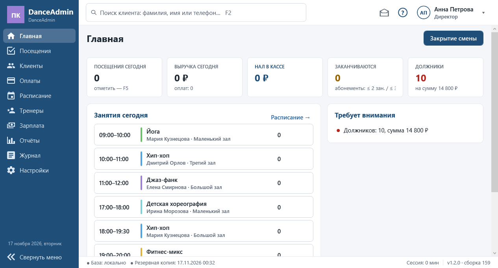

## Скачать

Раздел **[Releases](../../releases)**:

| Файл | Что это |
|---|---|
| `DanceAdmin_Setup_1.4.0b-178.exe` | **Установщик** (рекомендуется): ярлыки на рабочем столе и в меню «Пуск», удаление через «Приложения» Windows |
| `DanceAdmin_1.4.0b-178_portable.zip` | Переносная версия: распакуйте и запустите `DanceAdmin.exe`, без установки |

Бета-версия помечена в Releases как «Pre-release». Нужна проверенная версия — берите обычный выпуск 1.3.0 (`DanceAdmin_Setup_1.3.0-168.exe`).

Требуется Windows 10 / 11 (64-бит). .NET уже внутри, ничего дополнительно ставить не нужно.

Программа не подписана сертификатом, поэтому Windows SmartScreen может предупредить о «неизвестном издателе» — нажмите «Подробнее» → «Выполнить в любом случае».

## Обновления

Директор видит внизу окна «⬆ Доступна версия …» (программа проверяет при каждом входе и каждые 4 часа, если есть интернет; без интернета работает как обычно).
«Обновить сейчас» — программа скачает установщик, проверит его контрольную сумму, сделает резервную копию и обновится сама. Данные сохраняются.
Проверить вручную: **Настройки → Общие → О программе → «Проверить обновления»**. Там же — «Сообщать о бета-версиях» (предварительные версии с новыми возможностями; снимите галочку — только обычные выпуски). Переносную версию обновляют заменой файла `DanceAdmin.exe`.

## Первый запуск

1. Программа попросит создать **директора** и покажет 5 кодов восстановления пароля — сохраните их.
2. Директор добавляет администраторов (Настройки → Пользователи и права) и выдаёт им временный пароль — свой пароль сотрудник придумает при первом входе.
3. Данные хранятся в `C:\ProgramData\DanceAdmin\` (база, фото, резервные копии, логи). При удалении программы данные **не** удаляются.

Руководство — в программе: **Настройки → Общие → «Руководство администратора»** (по темам-вопросам, с оглавлением слева, можно распечатать и свернуть вниз окна), а также в [docs/ADMIN_GUIDE.txt](docs/ADMIN_GUIDE.txt).
На любой вопрос ответит **помощник**: значок «?» вверху окна или F1 — напишите своими словами, что нужно сделать.

## Возможности

- **Посещения** — отметка одним кликом на сегодняшних занятиях (или в любое время, если включено «без ограничения по времени»), шкала занятий абонемента, «в долг», продажа прямо из списка, отмена ошибочной отметки; раздел открывается в режиме «параллельно» (все клиенты слева, отмеченные справа) с фильтрами по возрасту и группам.
- **Абонементы** — продажа со скидкой (по праву роли), переплата на баланс клиента (учитывается при следующей продаже, зачитывается с долгом), изменение стоимости в корректировке, общий абонемент на нескольких человек, на число занятий и безлимитные, группы абонементов, старт с первого посещения, автостарт после срока ожидания, заморозки с лимитами у каждого типа, доплата за посещение по направлению, покупка заранее, **индивидуальные занятия** (бессрочный абонемент на одно занятие; на занятие — один человек или группа), корректировка («Использовано» числом, отдельное право), бессрочный абонемент кнопкой «∞ Бессрочно» с возвратом срока, свои причины заморозки.
- **Клиенты** — карточка с абонементами, посещениями и финансами, долги, красный флажок для важных замечаний, семья клиента, загрузка списка из Excel, фамилия, телефон и возрастная категория необязательны, возрастная категория и группа прямо в окне клиента, группы клиентов с особыми условиями (скидка, своя цена, ставка тренеру), наполнение групп «параллельно», фото, архив, поиск по ФИО и телефону (F2).
- **Оплаты и касса** — аренда зала с отметкой в расписании, частичная оплата → долг, погашение, прочие оплаты, расходы, возвраты, аннулирование, защита от двойной продажи; касса **за сотрудником** (с остатком прошлой смены) или **общая**.
- **Расписание** — шаблоны недели, календарь, несколько залов, замена тренера (⇄), отмена занятий; фильтры по тренеру, залу и направлению, печать и PDF выбранной недели; цвет ячеек — по направлению или по тренеру.
- **Зарплата** — тренеру за каждое посещение по ставке типа абонемента (с коррекцией ставки для тренера и минимальной оплатой за занятие; по щелчку в истории — детали начисления); сотрудникам — по правилам роли: повременно (по сменам или время проставляет сам), за отметки, фиксированно; свои ставки сотрудника; выдачи и коррекции.
- **Отчёт смены** — сквозной номер, колонка «Способ» у всех денег, абонементы / тренировки / иная оплата / иной расход и возвраты / зарплата, «Поступило в кассу за текущую смену», сверка кассы, большой вид для фото с телефона и **QR-код** с текстом отчёта, печать, автосохранение в папку, **отправка в Telegram** (PDF, Excel или текст).
- **Аналитика** — графики: выручка по месяцам за год, по тренерам и залам, выручка и расходы, новые и ушедшие клиенты, загрузка залов, посещения по дням и часам.
- **Пользователи и права** — директор и администраторы, права деревом (группы с подпунктами), перенос ролей экспортом, временные пароли, коды восстановления, автоблокировка и кнопка-замок (Ctrl+L), журнал всех действий с «Было / Стало» обычными словами.
- **Снимок рабочего компьютера** — рабочий компьютер сам сохраняет копию в облачную папку (Облако Mail.ru, Яндекс Диск, OneDrive), а директор или сотрудник с правом смотрит её на другом компьютере (несколько рабочих компьютеров в одной папке не смешиваются): отчёты, журнал, клиенты — только просмотр, без перезапуска и пароля, новый снимок открывается сам.
- **Данные** — перенос абонементов и долгов из старого учёта (архив клиентов, значок «перенос не сделан» и перенос прямо при отметке), импорт из JSON или zip с предпросмотром и откатом, выгрузка клиентов, тренеров, расписания и справочников одним zip, ежедневные резервные копии одним zip (база, фото, логотип) + вторая папка (флешка, Яндекс Диск, Облако Mail.ru, OneDrive), восстановление из любого файла копии с перечнем того, что пропадёт; копии хранятся по дням, неделям и месяцам; при повреждённой базе — пошаговая инструкция.
- **Печать и Excel** — расписание занятий (альбомный лист: сетка недели и дни) и прайс абонементов (по группам, в два столбика) с выбором направлений, залов и абонементов, пресетами и просмотром; **лист пополам** (расписание + прайс, два расписания или два прайса — разрезать); в шапке вид, название и телефон клуба; отчёты смен, журнал и история клиента — печать, PDF и **Excel (.xlsx)**.
- **Сообщения сотрудникам** — внутренняя почта с цветными смайликами, «показать при входе».
- **Помощник** — значок «?» или F1: понимает слова в любой форме и с опечатками, словарь терминов программы, раздел «Обновления и что нового».
- **Внешний вид** — светлая и тёмная темы, пять пастельных цветовых гамм, логотип клуба, масштаб интерфейса, режимы «список / карточки». Рассчитан на экран ноутбука от 1280×720.

| | |
|---|---|
| 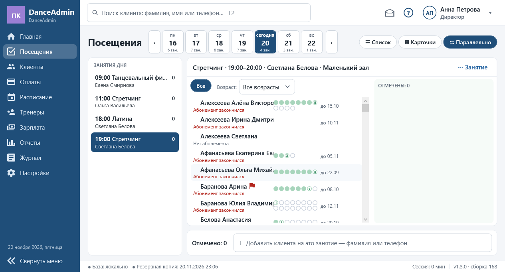 | 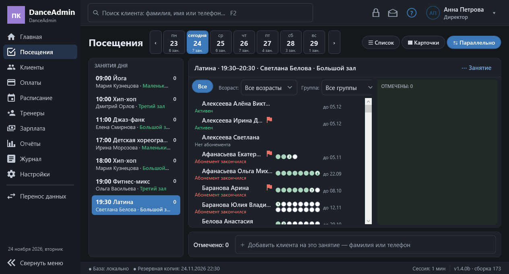 |
| 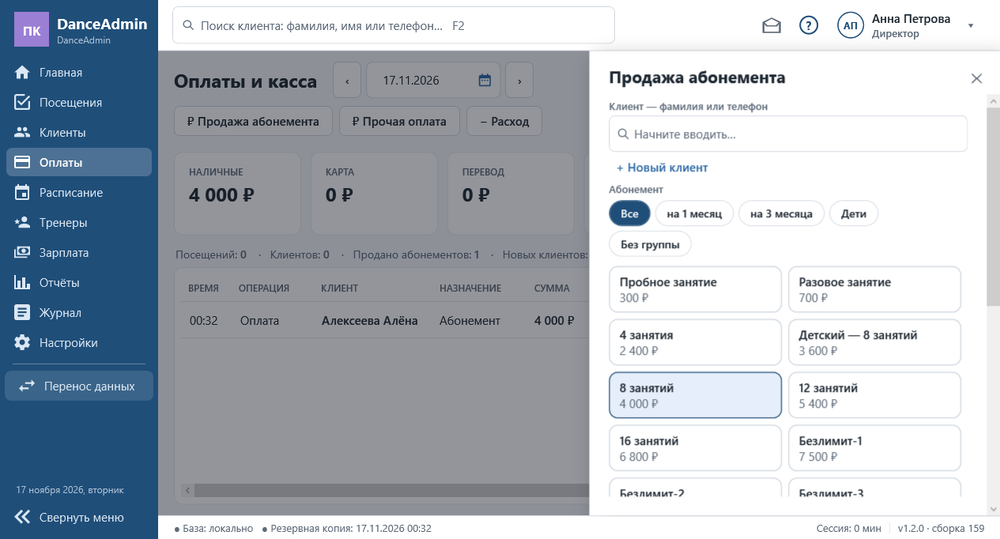 | 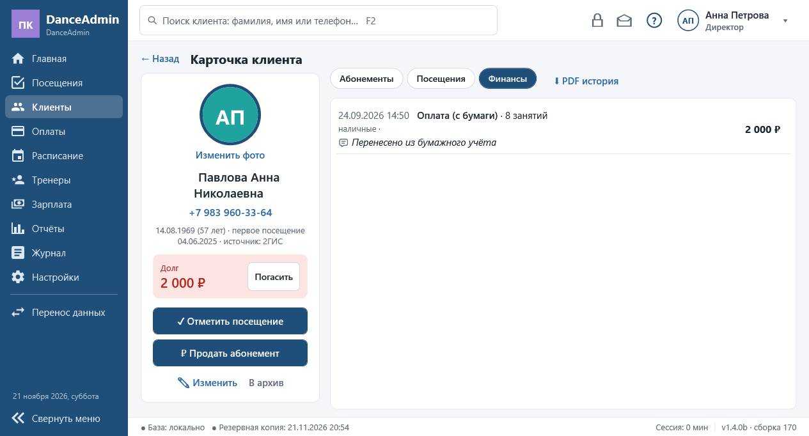 |
| 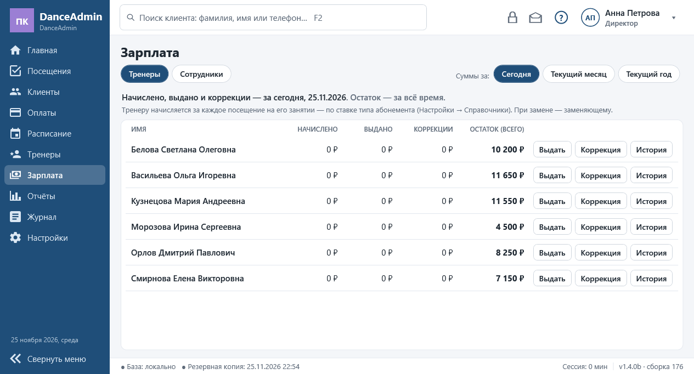 | 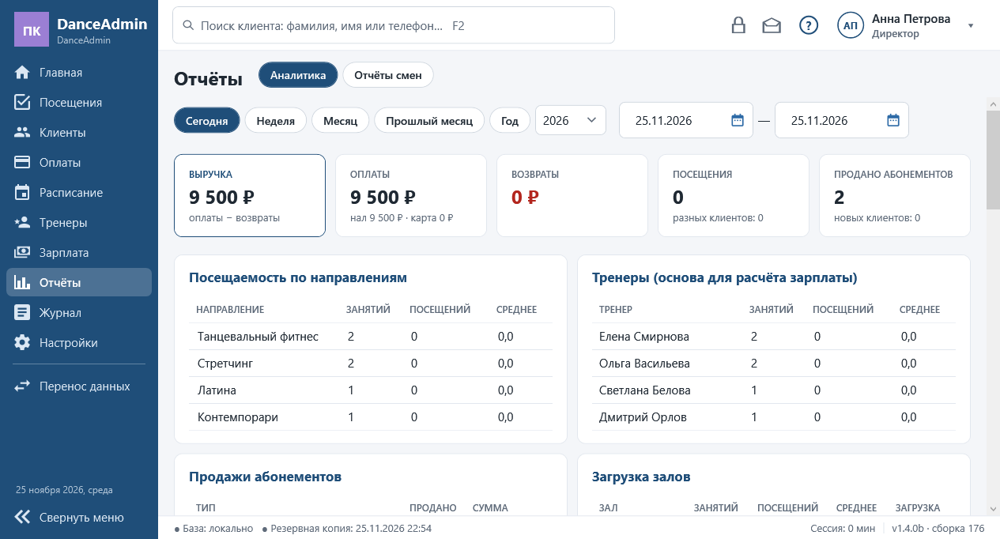 |
| 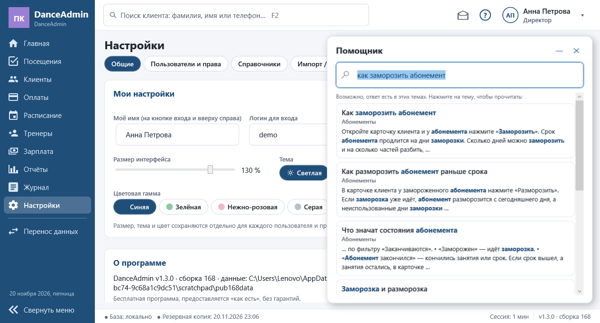 | 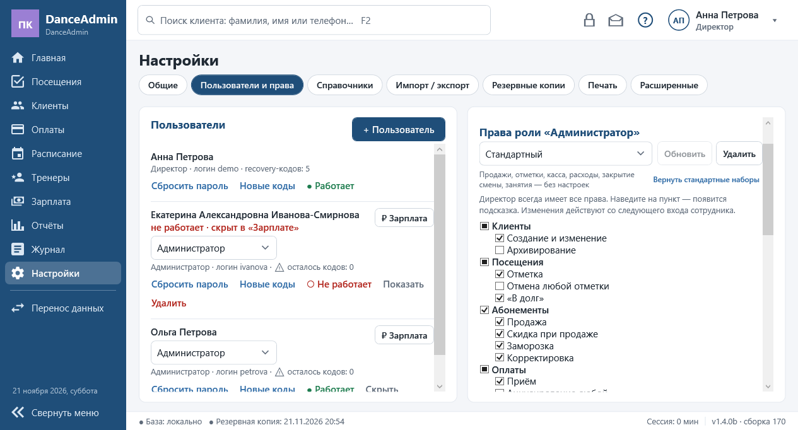 |
| 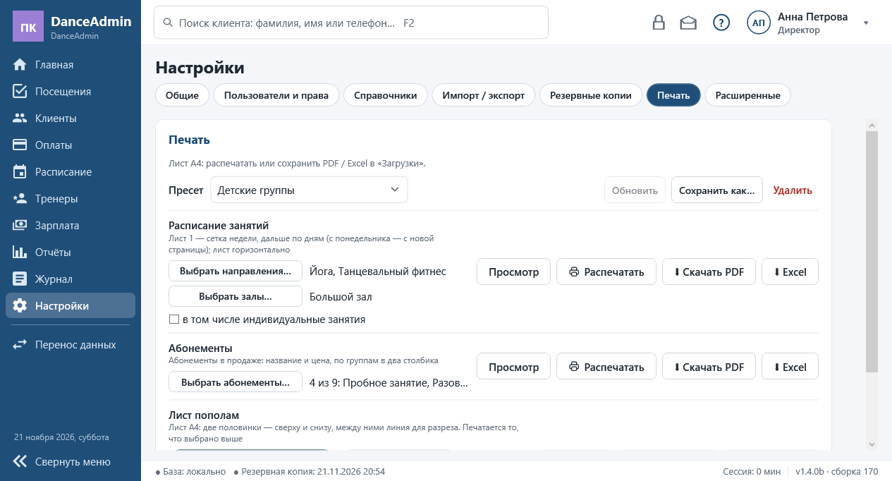 | 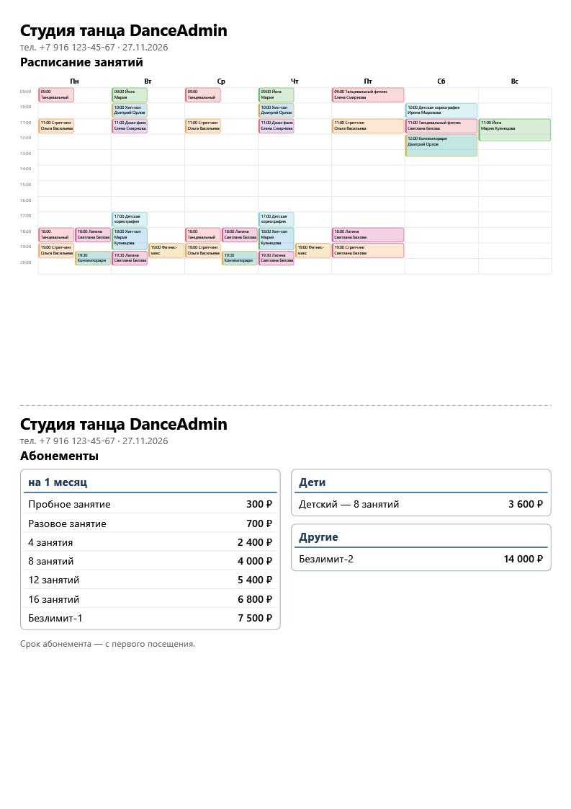 |
| 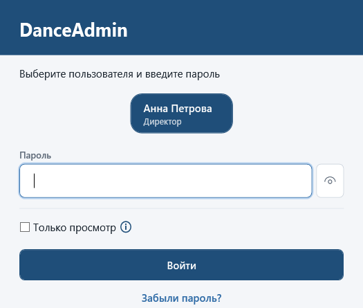 | 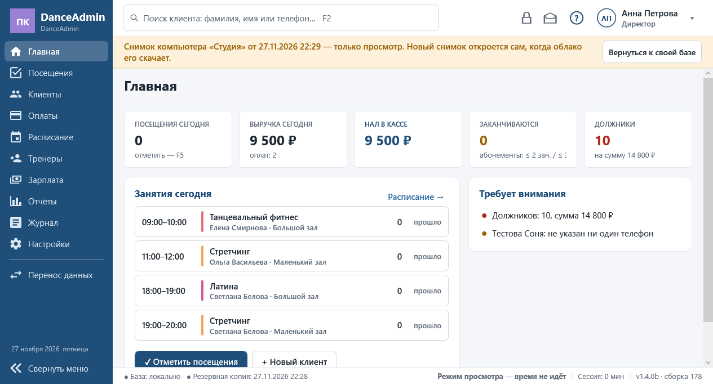 |

На скриншотах — вымышленные данные.

## Попробовать на тестовых данных

Чтобы не трогать рабочую базу, задайте отдельную папку данных и запустите программу из той же командной строки:

```bat
set DANCEADMIN_DATA=D:\DanceAdminTest
"C:\Program Files\DanceAdmin\DanceAdmin.exe"
```

Затем **Настройки → Импорт / экспорт → Выбрать файл…** и [`test-data/danceadmin_full.json`](test-data) (100 вымышленных клиентов, 6 тренеров, история за две недели).
Или по шагам: `01_references.json` → `02_migration.json` → `03_operations.json`. Любой импорт можно откатить. Формат файлов — [test-data/README.md](test-data/README.md).

## Горячие клавиши

| Клавиша | Действие |
|---|---|
| F1 | Помощник |
| F2 | Поиск клиента |
| F5 | Посещения |
| F6 | Оплаты |
| Ctrl+N | Новый клиент |
| Esc | Закрыть панель / назад |

## Лицензия

Бесплатная программа, предоставляется «как есть», без гарантий — см. [LICENSE.txt](LICENSE.txt).
Можно бесплатно использовать (в том числе в студии с коммерческой деятельностью) и передавать в неизменённом виде.
Исходный код закрыт. Продажа, изменение и декомпиляция программы не допускаются.
Используемые сторонние компоненты и их лицензии — [THIRD-PARTY-NOTICES.txt](THIRD-PARTY-NOTICES.txt).

История изменений — [CHANGELOG.md](CHANGELOG.md).
