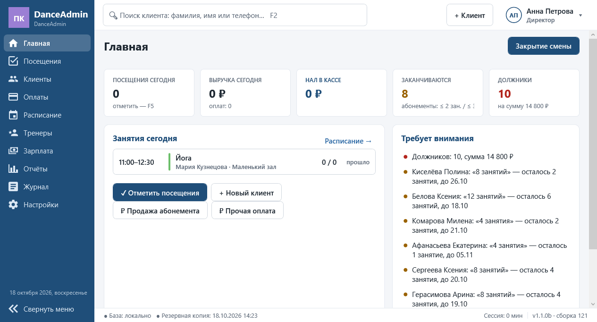
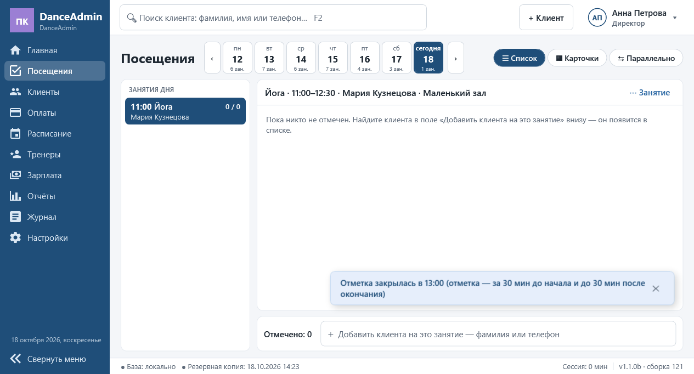
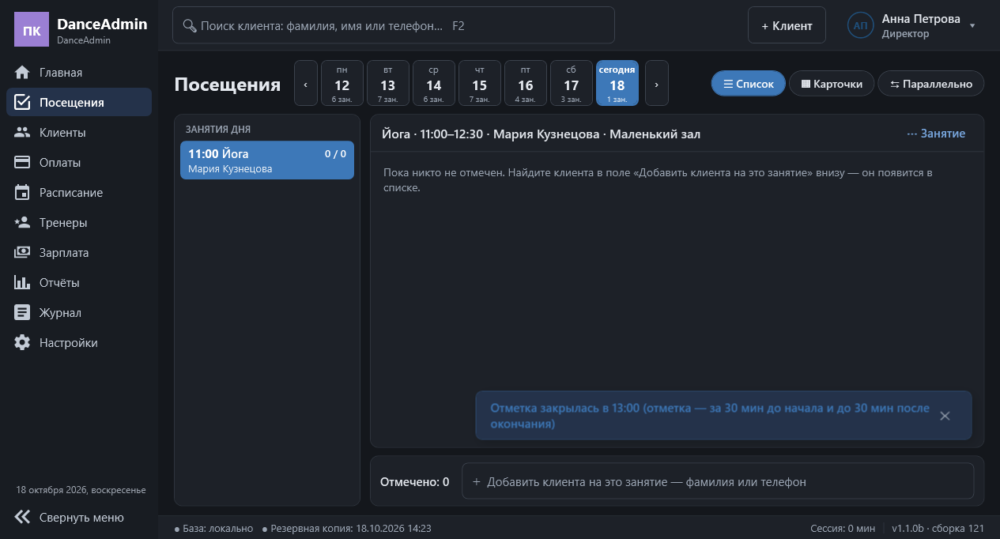
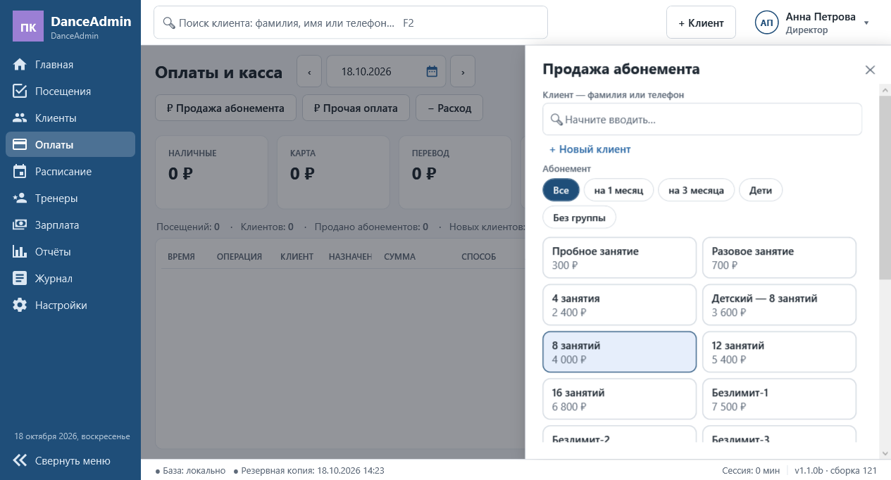
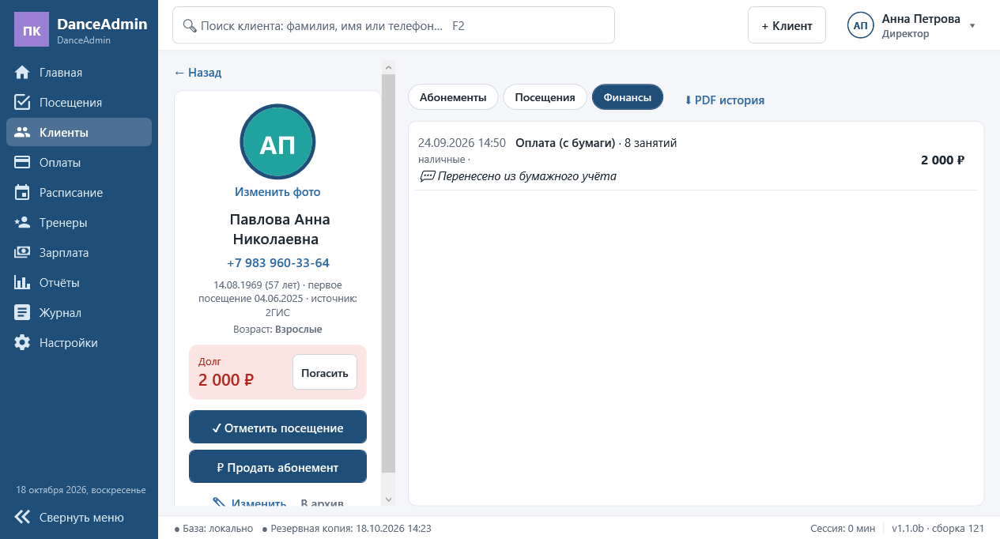
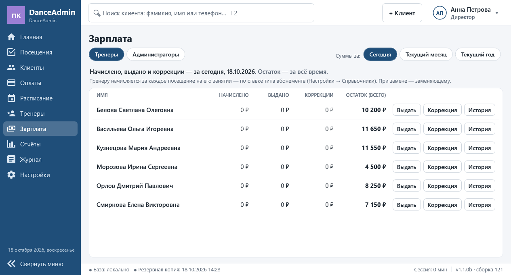
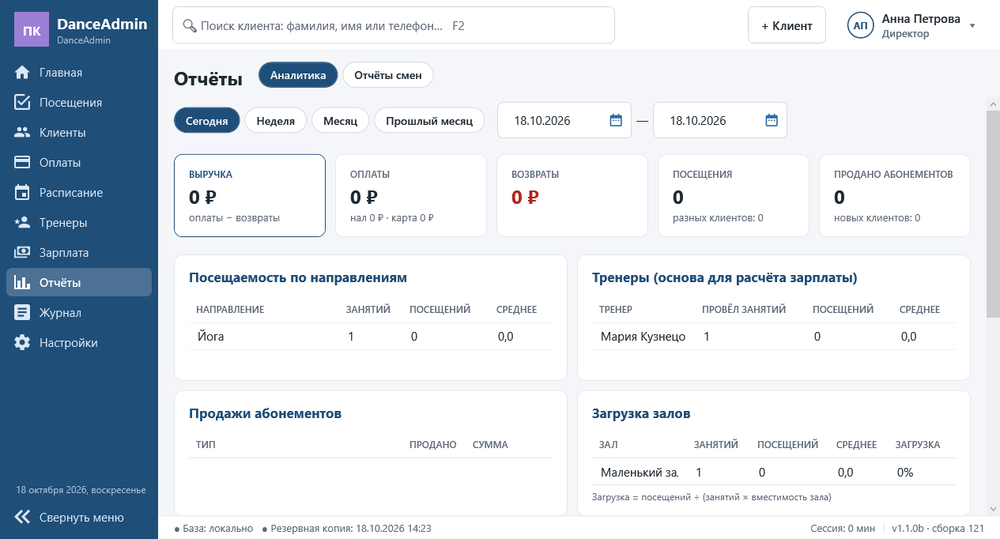

# DanceAdmin

> **Бета-версия 1.1.0b (сборка 121).** Программа работает, но ещё проверяется в реальной студии. Делайте резервные копии (в программе это пара кликов) и сообщайте об ошибках через [Issues](../../issues).

Учёт для небольшой танцевальной или фитнес-студии: клиенты, абонементы, посещения, оплаты, расписание, зарплата тренеров и администраторов, отчёты смен.
Windows, работает **без интернета**, все данные хранятся только на компьютере студии. Интерфейс на русском, деньги — в рублях.



## Скачать

Раздел **[Releases](../../releases)**:

| Файл | Что это |
|---|---|
| `DanceAdmin_Setup_1.1.0b-121.exe` | **Установщик** (рекомендуется): ярлыки на рабочем столе и в меню «Пуск», удаление через «Приложения» Windows |
| `DanceAdmin_1.1.0b-121_portable.zip` | Переносная версия: распакуйте и запустите `DanceAdmin.exe`, без установки |

Требуется Windows 10 / 11 (64-бит). .NET уже внутри, ничего дополнительно ставить не нужно.

Программа не подписана сертификатом, поэтому Windows SmartScreen может предупредить о «неизвестном издателе» — нажмите «Подробнее» → «Выполнить в любом случае».

## Обновления

Директор видит внизу окна «⬆ Доступна версия …» (программа проверяет раз в сутки, если есть интернет; без интернета работает как обычно).
«Обновить сейчас» — программа скачает установщик, проверит его контрольную сумму, сделает резервную копию и обновится сама. Данные сохраняются.
Проверить вручную: **Настройки → Общие → О программе → «Проверить обновления»**. Переносную версию обновляют заменой файла `DanceAdmin.exe`.

## Первый запуск

1. Программа попросит создать **директора** и покажет 5 кодов восстановления пароля — сохраните их.
2. Директор добавляет администраторов (Настройки → Пользователи и права) и выдаёт им временный пароль — свой пароль сотрудник придумает при первом входе.
3. Данные хранятся в `C:\ProgramData\DanceAdmin\` (база, фото, резервные копии, логи). При удалении программы данные **не** удаляются.

Руководство для администраторов — в программе: **Настройки → Общие → «Руководство администратора»** (можно распечатать), а также в [docs/ADMIN_GUIDE.txt](docs/ADMIN_GUIDE.txt).

## Возможности

- **Посещения** — отметка одним кликом на сегодняшних занятиях, шкала занятий абонемента, «в долг», продажа прямо из списка, отмена ошибочной отметки.
- **Абонементы** — на число занятий и безлимитные, группы абонементов, старт с первого посещения, автостарт после срока ожидания, заморозки с лимитами у каждого типа, доплата за посещение по направлению, покупка заранее, корректировка директором.
- **Клиенты** — карточка с абонементами, посещениями и финансами, долги, красный флажок для важных замечаний, возрастные категории, группы клиентов с особыми условиями (скидка, своя цена, ставка тренеру), наполнение групп «параллельно», фото, архив, поиск по ФИО и телефону (F2).
- **Оплаты и касса** — частичная оплата → долг, погашение, прочие оплаты, расходы, возвраты, аннулирование, защита от двойной продажи.
- **Расписание** — шаблоны недели, календарь, несколько залов, замена тренера (⇄), отмена занятий.
- **Зарплата** — тренеру за каждое посещение по ставке типа абонемента; сотрудникам — по правилам роли: повременно (по сменам или время проставляет сам), за отметки, фиксированно; свои ставки сотрудника; выдачи и коррекции.
- **Отчёт смены** — сквозной номер, абонементы / тренировки / расходы, сверка кассы, большой вид для фото с телефона и **QR-код** с текстом отчёта, печать, автосохранение в папку.
- **Пользователи и права** — директор и администраторы, права по пунктам, временные пароли, коды восстановления, автоблокировка, журнал всех действий.
- **Данные** — импорт из JSON или zip с предпросмотром и откатом, выгрузка клиентов, тренеров, расписания и справочников одним zip, ежедневные резервные копии + вторая папка (флешка, облако), восстановление из любого файла копии.
- **Печать** — расписание занятий и прайс абонементов (лист А4, PDF), отчёты смен и история клиента.
- **Внешний вид** — светлая и тёмная темы, пять пастельных цветовых гамм, логотип и значок клуба, масштаб интерфейса, режимы «список / карточки». Рассчитан на экран ноутбука от 1280×720.

| | |
|---|---|
|  |  |
|  |  |
|  |  |

На скриншотах — вымышленные данные.

## Попробовать на тестовых данных

Чтобы не трогать рабочую базу, задайте отдельную папку данных и запустите программу из той же командной строки:

```bat
set DANCEADMIN_DATA=D:\DanceAdminTest
"C:\Program Files\DanceAdmin\DanceAdmin.exe"
```

Затем **Настройки → Импорт / перенос → Выбрать файл…** и [`test-data/danceadmin_full.json`](test-data) (100 вымышленных клиентов, 6 тренеров, история за две недели).
Или по шагам: `01_references.json` → `02_migration.json` → `03_operations.json`. Любой импорт можно откатить. Формат файлов — [test-data/README.md](test-data/README.md).

## Горячие клавиши

| Клавиша | Действие |
|---|---|
| F2 | Поиск клиента |
| F5 | Посещения |
| F6 | Оплаты |
| Ctrl+N | Новый клиент |
| Esc | Закрыть панель / назад |

## Лицензия

Бесплатная программа, предоставляется «как есть», без гарантий — см. [LICENSE.txt](LICENSE.txt).
Можно бесплатно использовать (в том числе в студии с коммерческой деятельностью) и передавать в неизменённом виде.
Исходный код закрыт. Продажа, изменение и декомпиляция программы не допускаются.
Используемые сторонние компоненты и их лицензии — [THIRD-PARTY-NOTICES.txt](THIRD-PARTY-NOTICES.txt).

История изменений — [CHANGELOG.md](CHANGELOG.md).
